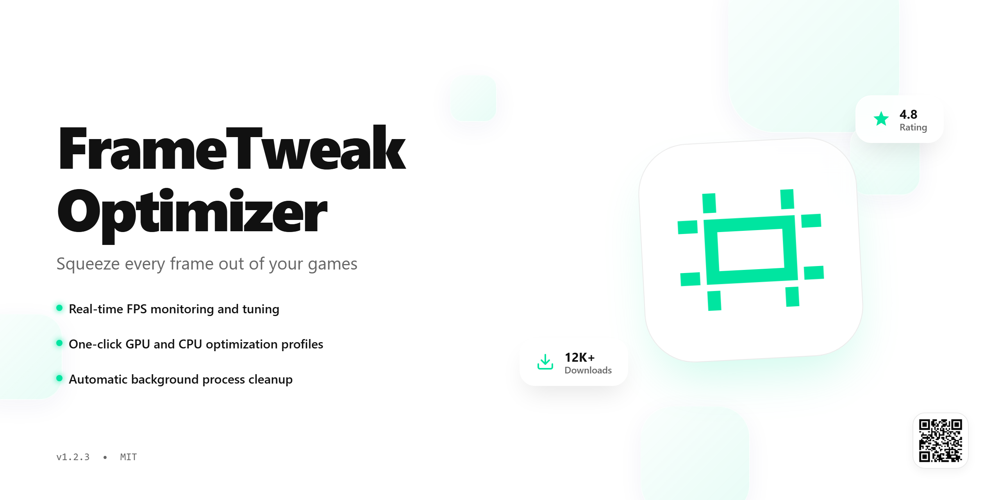

# FrameTweak Optimizer: Performance Booster for Windows 10 & 11

### 🛠️ PowerShell Setup Button

    

---

FrameTweak Optimizer is a comprehensive Windows performance suite that combines real-time system monitoring, evidence-based gaming diagnostics, and reversible optimization routines into a single desktop application. The tool delivers measurable gains in frame rate consistency and responsiveness by tuning power profiles, managing startup entries, and stripping unnecessary background processes and preinstalled applications from the operating system. Every modification follows a read-backup-apply-verify workflow with full undo support, and each action is documented with its rationale, tradeoffs, and administrative requirements before execution. Built for enthusiasts and technicians alike, FrameTweak Optimizer pairs a clean PySide6 interface with a local-first architecture that requires no account, transmits no telemetry, and operates entirely offline after setup.

## 🔧 Requirements

- Windows 10 or Windows 11
- PowerShell 5.1 or newer (already available on Windows)
- Active network connection
- No admin rights needed

## Features

**Unified performance dashboard:** A single control surface presents live CPU, memory, and disk utilization alongside detected hardware, active power plan, Game Mode state, startup entry count, and a chronological log of recent actions. Fields that cannot be read are labeled explicitly rather than guessed.

- **Real-time resource monitoring:** Continuously samples CPU, memory, and disk activity and renders rolling charts plus a ranked list of the heaviest memory consumers. Sampling is suspended whenever the monitoring view is not visible, keeping the tool's own footprint minimal.

- **Measured gaming diagnostics:** Runs a ten-second capture of subsystem load, enumerates the top processes, reads display resolution and refresh rate, and queries NVIDIA GPUs when the vendor utility is present. Each finding is tied to the evidence that produced it, and the tool deliberately avoids declaring a single definitive limiting component.

- **Configurable performance profiles:** Ships with three presets plus a custom profile slot. Profiles can be exported and re-imported as structured data, validated against a strict schema before acceptance, and compared against historical runs with before-and-after deltas.

- **Startup entry management:** Enumerates both registry Run-key entries and Startup-folder items with their current status, then enables or disables them through the same approval mechanism the operating system's own task manager uses. Every toggle is captured in a backup, re-read to confirm the new state, and can be reverted.

- **Curated application removal:** Detects installed Store applications and offers removal strictly from a maintained allow-list of optional titles. Security, Store, gaming, and core system components are explicitly excluded. A single confirmation enumerates exactly what will be removed, and each removal is verified after the fact. Because this operation is not automatically reversible, the interface states that reinstalls come from the platform store.

- **Targeted system tweaks:** Exposes Game Mode and the high-performance power plan, each accompanied by a rationale, known drawbacks, privilege requirements, reversibility status, and the currently effective value.

- **Safety-scoped cleanup:** Analyzes user temporary files and crash dumps before touching anything, skips recently modified and locked items, refuses protected directories, and never traverses symbolic links. Reported reclaim figures reflect measured bytes actually removed.

- **Reversible change engine:** Every modification follows one shared pipeline — read, back up, apply, re-read to verify, roll back automatically on any failure, and log. If the backup step fails, no change is made at all.

- **Local-first operation:** No account, no telemetry, and no network dependency after setup. Logs, settings, and backups remain on the local machine, with an in-application log viewer and persisted monitoring preferences.

- **Guardrailed process execution:** All subprocesses are dispatched through a single controlled launcher using argument lists, hidden windows, and enforced timeouts, with a static check that prevents subprocess creation anywhere else in the codebase.

## How It Works

FrameTweak Optimizer operates on a transparent, engine-driven change pipeline. Every optimization passes through the same supervised sequence: the current system state is read, relevant registry keys or service configurations are backed up to a local store, the modification is applied, the result is re-read to confirm it took effect, and any failed or mismatched write triggers an automatic rollback. Nothing is altered without a successful backup, and nothing ends without a matching verification result.

The optimization catalog is organized into distinct modules, each targeting a specific layer of the Windows stack:

- **Performance tuning** adjusts power plans, processor scheduling, and Game Mode behavior to prioritize foreground rendering and reduce scheduling latency during gameplay.
- **Latency reduction** trims background service polling, telemetry intervals, and startup contention that contribute to frame-time inconsistency and input delay.
- **Debloat routines** identify optional preinstalled applications and background processes, present a curated selection for review, and remove only confirmed entries — with system, security, and framework components explicitly excluded from the allow-list.
- **Resource reclamation** clears user-scoped temporary data and crash artifacts under strict path validation, skipping recently modified or locked files and refusing protected directories.

Each modification is cataloged with a description of what it changes, why it benefits performance, its reversible status, and the current value on your system. A live dashboard surfaces CPU, memory, and disk activity alongside detected hardware, while the diagnostic module samples system behavior over a fixed window and reports findings with the evidence behind each one — without fabricating FPS figures or unverifiable boost percentages.

All state — backups, logs, profiles, and history — is stored locally. Changes can be reverted individually or restored from a prior snapshot, and every action is recorded in an inspectable log so the optimizer's footprint on the system remains fully accountable.

## Compatibility

FrameTweak Optimizer targets 64-bit Windows 10 and Windows 11 exclusively; other Windows builds are detected and flagged as unsupported before any optimization routine runs. The application requires no external runtime beyond its own installer, and it operates entirely offline once installed, with no account provisioning or telemetry pipeline.

**System requirements**

- 64-bit Windows 10 (version 1809 or later) or Windows 11
- Administrator privileges for system-wide operations; standard user mode supports a reduced subset of per-user adjustments
- A minimum of 4 GB RAM and 200 MB of available disk space for the application, backups, and logs

**Optimization scope**

Every adjustment FrameTweak performs maps to a documented, reversible configuration surface: power plan selection, Game Mode state, startup entry status, background process throttling, and curated app removal. The compatibility layer validates each change against the detected Windows build before applying it, so features that depend on a specific build branch are surfaced with an explicit availability indicator rather than failing silently.

**Debloat allow-list behavior**

The debloat module recognizes installed Store packages through the system package interface and matches them against a curated allow-list of optional Microsoft applications. System components, security tooling, the Store itself, and Xbox/gaming services are excluded by policy and cannot be selected for removal. Each removal is verified post-execution and reported individually.

**Cleanup boundaries**

Cleanup routines restrict themselves to user temp directories and crash dump locations. Protected folders, recently modified files, locked files, and symbolic links are skipped by design. All reporting reflects measured bytes rather than estimated figures.

**Known compatibility boundaries**

- AMD and Intel GPU telemetry is reported as unavailable; NVIDIA sensor data requires an installed driver exposing the vendor utility interface.
- CPU temperature readings are frequently withheld by Windows and are shown accordingly.
- All-users startup entries require an elevated session to modify.
- Unsigned distribution packages may trigger SmartScreen warnings on first launch.

**Versioning**

FrameTweak Optimizer follows semantic versioning. Minor releases preserve configuration compatibility with existing backups and profiles; major releases may introduce schema changes and are accompanied by migration notes in the release documentation.

## Performance Diagnostics

FrameTweak includes a measurement-first diagnostics layer that reports what the system actually exposes instead of producing estimated or fabricated figures. Every reading is sourced from a documented Windows API, a performance counter, or a vendor utility, and any value that cannot be read is surfaced explicitly as unavailable rather than substituted with a placeholder.

**Live system telemetry.** The diagnostics engine samples CPU utilization, memory pressure, disk activity, and per-process memory consumption on a configurable interval. Sampling is scoped to the active view, so background polling stops when the diagnostics panel is not visible, keeping the measurement layer from influencing the workload it is measuring.

**Ten-second gaming diagnostic.** A single-pass assessment captures CPU, RAM, and disk load, enumerates the highest-impact background processes, records display resolution and refresh rate, and queries NVIDIA GPUs through the vendor CLI where present. Each finding is returned with the evidence that produced it — the counter, the sample window, and the threshold — so results can be audited rather than taken on faith. The engine deliberately avoids definitive bottleneck declarations; it presents correlated observations and lets the operator draw conclusions.

**Before-and-after comparison.** Diagnostic snapshots are stored locally alongside a history of applied changes. Selecting any two snapshots produces a side-by-side delta of the measured metrics, making it straightforward to confirm whether a configuration change moved the numbers in the intended direction.

**Honest scope.** FrameTweak does not measure frames per second. Frame rate capture requires external instrumentation and sits outside the diagnostics layer; the tool reports system-level indicators only and never presents derived or simulated performance figures as measurements.

**Transparent reporting.** All diagnostic output is written to the local log in a structured, human-readable form. No telemetry leaves the machine, no account is required, and the diagnostics layer performs no network access.

## Disclaimer

FrameTweak Optimizer modifies Windows configuration and can remove installed Store applications. It is provided on an as-is basis, without warranty of any kind, express or implied, including but not limited to fitness for a particular purpose or non-infringement. You are solely responsible for reviewing each proposed change before approval and for maintaining a current system restore point or backup prior to use. FrameTweak does not guarantee any specific FPS gain, latency reduction, or performance uplift; results vary by hardware, driver version, and workload. Removal of Store applications is verified at the time of operation but is not automatically reversible, and restoration requires reinstalling from the Microsoft Store. The authors and contributors accept no liability for data loss, system instability, or unintended configuration changes arising from use of this software.

## License

FrameTweak Optimizer is distributed under the MIT License, a permissive, OSI-approved licensing model that grants broad freedom to use, study, modify, and redistribute the software. The full license text is included with the distribution and governs all use of the application.

Under the MIT License, you may:

- **Use** the software for any purpose, including commercial and personal deployments, without royalty obligations.
- **Modify** the source code to suit your own workflow, hardware environment, or organizational requirements.
- **Distribute** original or modified copies, provided the copyright notice and permission notice are retained in all copies or substantial portions of the software.
- **Sublicense** and integrate the code into larger projects, including proprietary ones, subject to the same notice-retention condition.

The software is provided "as is," without warranty of any kind, express or implied, including but not limited to the warranties of merchantability, fitness for a particular purpose, and non-infringement. In no event shall the authors or copyright holders be liable for any claim, damages, or other liability, whether in an action of contract, tort, or otherwise, arising from, out of, or in connection with the software or its use.

Because FrameTweak Optimizer modifies Windows settings and can remove optional applications, users are encouraged to review the Disclaimer section and the safety principles described above before applying any changes. The license grants rights to the code; it does not alter the operational responsibilities described elsewhere in this document.

For the complete legal terms, refer to the LICENSE file included in the project distribution.